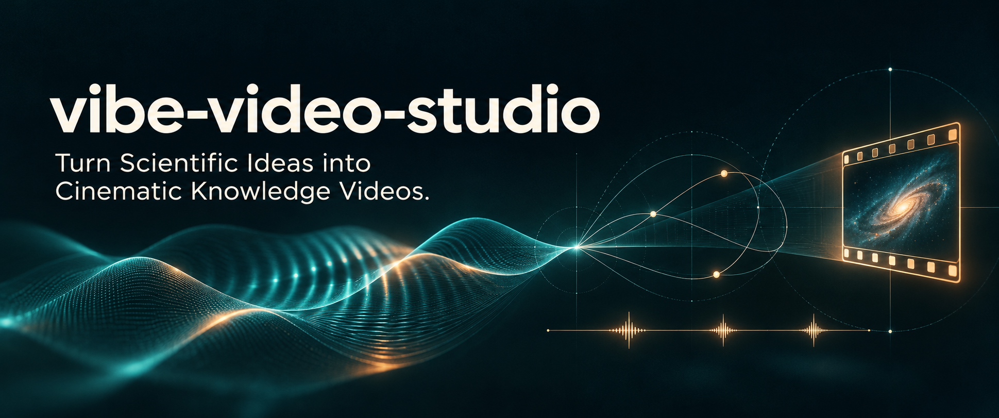
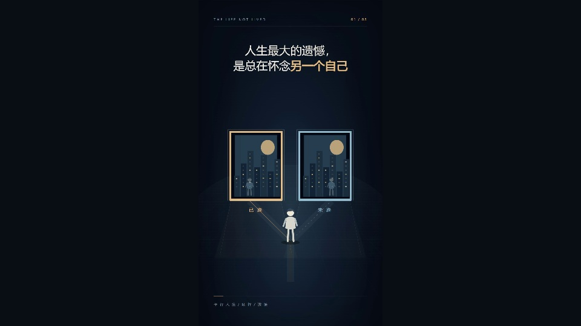
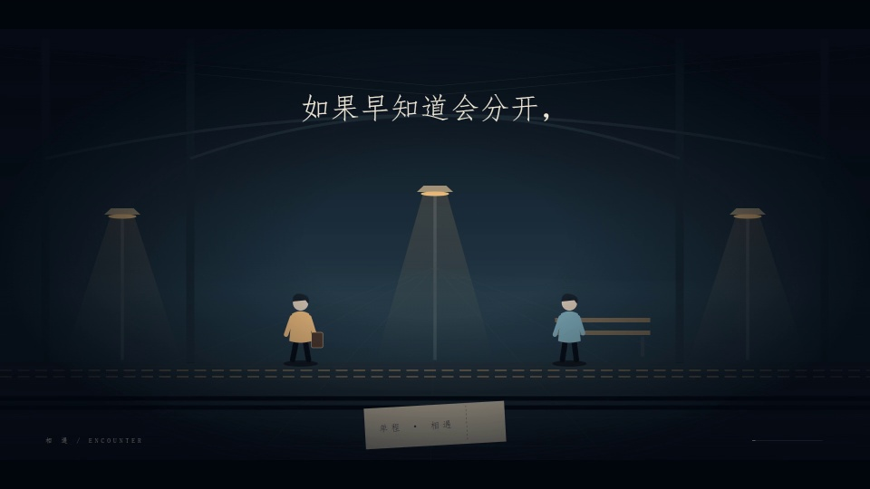
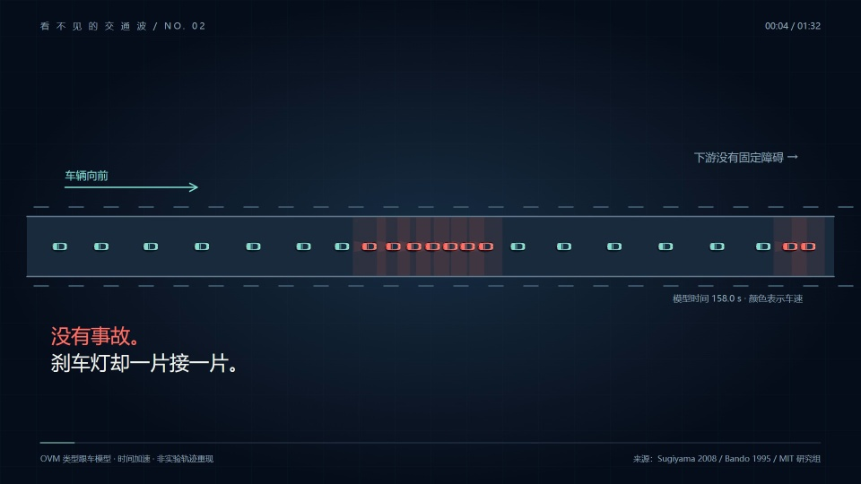
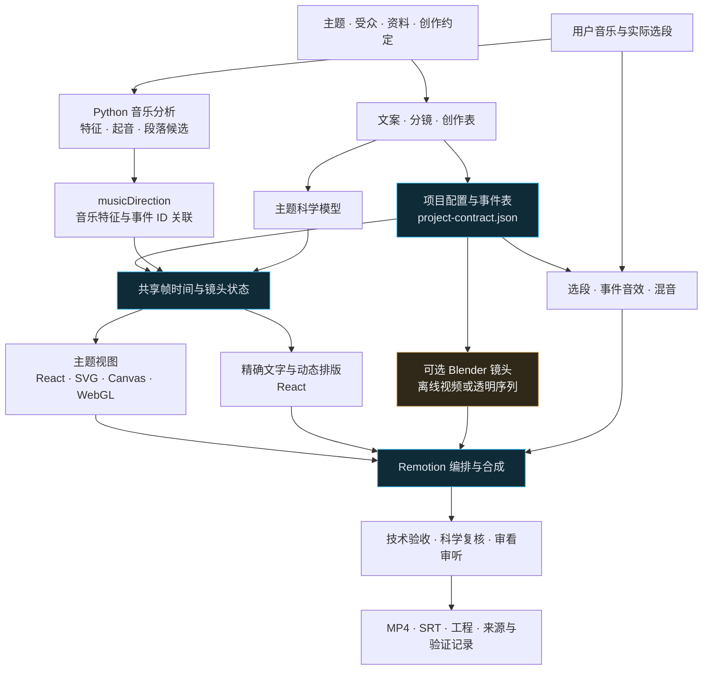

<div align="center">

# vibe-video-studio

### 将科学创意转化为电影感知识视频




[作品展示](#作品展示) · [快速开始](#快速开始) · [核心功能](#核心功能) · [系统架构](#系统架构) · [文档导航](#文档导航) · [参与贡献](#参与贡献)

</div>

## 项目简介

把一个科学问题，发展成有文案、有过程、有声画互动的知识短片。`vibe-video-studio` 为 AI 编码助手提供从选题、资料核验、叙事与分镜，到模型动画、音乐分析、Remotion 合成及交付的工作流。

- **让机制可见**。根据主题选择对象、条件、尺度和运动，展示过程如何改变结果。
- **让音乐参与叙事**。分析起音、节奏和段落，围绕理解与揭示安排蓄势、动作和落定。
- **让文字与画面协作**。完整文案分时呈现，结合叙事短句、对象标签和公式，保留稳定阅读时间。
- **让作品能够复现**。统一项目配置、帧时间、事件和固定随机种子，支持关键帧、局部渲染与技术检查。

适用于科学可视化、科普短剧，以及融合知识与生活思考的视频。调用时确定主题、受众、希望传达的思考、集数、各集时长、画幅和帧率。默认美术采用深色空间、有限强调色与电影感，可按项目调整。

## 作品展示

点击海报，在 B 站观看完整作品。

<table>
  <tr>
    <td width="33%" align="center">
      <a href="https://www.bilibili.com/video/BV1df4g6oEtm/">
        
      </a>
      <br />
      <strong>人生最大的遗憾，是总在怀念另一个自己</strong>
      <br />
      选择、未走的路与想象中的人生
      <br />
      <a href="https://www.bilibili.com/video/BV1df4g6oEtm/">观看作品 ↗</a>
    </td>
    <td width="33%" align="center">
      <a href="https://www.bilibili.com/video/BV1ax4g6JEaC/">
        
      </a>
      <br />
      <strong>如果早知道会分开……</strong>
      <br />
      用场景、动作与音乐讲述相遇
      <br />
      <a href="https://www.bilibili.com/video/BV1ax4g6JEaC/">观看作品 ↗</a>
    </td>
    <td width="33%" align="center">
      <a href="https://www.bilibili.com/video/BV1HNxf6NEaw/">
        
      </a>
      <br />
      <strong>前面明明没事故，为什么整条路堵死了？</strong>
      <br />
      车辆跟驰、制动传播与交通波
      <br />
      <a href="https://www.bilibili.com/video/BV1HNxf6NEaw/">观看作品 ↗</a>
    </td>
  </tr>
</table>

## 快速开始

### 安装技能

通过 skills 命令行工具安装到支持的 AI 助手。

```bash
npx skills add win520-1206/vibe-video-studio --skill vibe-video-studio
```

安装到用户级 Codex。

```bash
npx skills add win520-1206/vibe-video-studio --skill vibe-video-studio --agent codex --global
```

也可将包含 `SKILL.md` 的整个目录放入助手的 skills 目录。安装器通过 npm 运行，并从 GitHub 获取本项目。

### 制作第一部视频

在助手中调用技能，给出本次创作需求。

```text
使用 $vibe-video-studio 制作一部关于反馈与稳定性的知识短片。
面向大学生，结合生活中的反复修正，先交付可播放样片。
横屏，时长约一分钟。音乐和参考资料在当前工作目录。
请先分析音乐，再设计主体变化、动态文字和关键揭示。
```

助手会补齐尚缺参数，建立独立工程，核验资料，分析音乐并设计镜头。每个主题编写自己的模型、场景与视觉组织。确认后的完整文案用于覆盖检查和 SRT 交付。

### 本地运行工程

准备 Node.js、Python、NumPy、可用的 FFmpeg/ffprobe，以及 Chrome、Edge 或 Chromium。在技能根目录执行以下命令，启动带合成音轨的独立接口诊断。

```bash
node scripts/create-project.mjs ../pipeline-test --demo
cd ../pipeline-test
npm ci
python -m pip install -r requirements.txt
npm run analyze:music
npm run doctor
npm run dev
```

创建正式作品时使用 `node scripts/create-project.mjs ../my-film`，填写项目约定、确认稿和科学来源，在 `shared/scene-registry.mjs` 与 `src/scenes.tsx` 注册本题材的模型状态和同名视图。目标目录须为空。诊断和两个原创机制示范各自独立，示范参数只用于验证。工程接口与工具路径配置见脚手架说明。[工程脚手架](references/scaffold.md)

| 命令 | 用途 |
| --- | --- |
| `analyze:track` | 在分镜完成前分析任意音轨，输出报告与试听页 |
| `plan:shots` / `check:creative` | 创建创作表，核对镜头、文案和事件引用 |
| `analyze:music` | 计算实际选段的音乐特征并生成混音 |
| `plan:music` / `check:music` | 提议声画绑定并核验落点和选段指纹 |
| `doctor` / `dev` | 检查环境与真实渲染帧，启动预览 |
| `stills` / `render` | 输出关键帧、全片或绝对帧范围片段 |
| `check` / `package` | 验收并打包视频、SRT、工程和资料 |
| `blender:render` | 渲染指定 Blender 镜头 |

## 核心功能


| 模块 | 创作与工程能力 |
| --- | --- |
| **叙事与文案** | 从疑问推导机制、认识变化与情绪联系，记录科学事实、教学模型、类比和作者观点的依据与边界 |
| **主题模型动画** | 为题材选择对象、尺度、动作和接续方式，使用 React、SVG、Canvas、WebGL，按镜头评估 Blender |
| **音乐与镜头节奏** | 生成起音、节奏、段落和冲击候选，关联具体动作，设计蓄势、揭示、衰减与落定 |
| **动态文字** | 将完整确认稿拆为短语，配置位置、对象锚点、关键词强调和稳定阅读窗口 |
| **可复现制作** | 以共享帧时间、事件 ID 和确定性状态重建画面，执行配置、布局、主体运动、媒体及交付检查 |

### 音乐分析与画面适配

音乐分析可以在分镜确定前独立运行。

```bash
python scripts/analyze_track.py --input "music.mp3" --output "music-analysis" --ffmpeg "ffmpeg"
```

分析输出包含特征、节奏与起音表、段落变化、候选动作组、报告、试听页及溯源记录。选段确定后，项目重新分析实际音乐，再将关键动作绑定到唯一事件。`ctx.accent(eventId)` 为镜头提供蓄势、冲击和落定包络。

算法结果保留候选状态，由实际听取和画面判断决定主揭示。换曲、选段、帧率或速度变化时重新核验。声画流程与字段见相关文档。[可复现音乐分析](references/music-analysis-workflow.md) · [节奏导演](references/music-direction.md)

## 系统架构



模型与绘图通过可按任意帧重建的状态连接。动作、文字强调和音效引用共享事件 ID。音乐处理由 `music_pipeline.py` 提供统一分析，整曲入口负责报告与试听页，项目入口负责选段和混音。缓存依据 PCM、参数、实现及运行环境匹配。[系统架构](references/architecture.md) · [音乐资源与缓存](references/music-adaptation.md)

```text
SKILL.md                  助手入口与任务路由
agents/                   助手界面元数据
references/               创作、科学、音乐、工程与验收文档
scripts/                  工程创建和音乐、媒体分析工具
assets/project-template/  项目运行底座
assets/diagnostics/       隔离接口诊断
assets/studies/           波的干涉与反馈纠偏示范
assets/styles/            可扩展美术方向
docs/media/               项目封面与作品海报
```

## 文档导航

| 主题 | 文档 |
| --- | --- |
| 需求、调用与迭代 | [工作流](references/workflow.md) · [项目约定](references/project-contract.md) |
| 主题、文案与情绪 | [主题设计](references/theme-led-design.md) · [融合叙事](references/creative-narrative.md) |
| 科学镜头与表达边界 | [科学镜头设计](references/scientific-shot-design.md) · [科学核验](references/scientific-integrity.md) |
| 文字、对象与运动 | [动态文案](references/dynamic-text-and-motion.md) · [动作与声音](references/motion-and-audio.md) |
| 音乐分析与镜头节奏 | [分析流程](references/music-analysis-workflow.md) · [节奏导演](references/music-direction.md) · [资源与缓存](references/music-adaptation.md) |
| 工程与三维接入 | [脚手架](references/scaffold.md) · [系统架构](references/architecture.md) · [工程实践](references/engineering.md) · [Blender](references/blender.md) |
| 验收与排错 | [验证规范](references/verification.md) · [制作经验](references/production-lessons.md) · [已运行验证记录](assets/validation-report.json) |

## 参与贡献

欢迎提交问题和合并请求，参与项目改进。

- **改进创作方法**。提供主题、观众需要理解的机制、文案到动作的推导，以及科学依据。
- **完善音乐适配**。描述输入选段、帧率、候选与实际落点，提供可复现步骤和必要的验证记录。
- **补充独立示范或风格**。为题材设计模型与视图，记录适用条件、素材来源和运行方式。
- **修复工程问题**。说明触发条件、预期与实际行为，执行与改动相关的类型检查和现有测试。

在生成的作品工程中运行开发检查。

```bash
npm run typecheck
npm test
npm run test:audio
```

提交前核对文档与接口一致性，登记引入素材和依赖的许可，检查公开文件范围。技术验证、科学复核、连续观看与实际审听分别记录结果。

[提交问题](https://github.com/win520-1206/vibe-video-studio/issues) · [参与贡献](https://github.com/win520-1206/vibe-video-studio/pulls)

### 致谢与许可

项目封面由 AI 生成，作品海报截取自上方展示的视频。整体代码许可证尚待维护者选定。第三方方法来源与依赖遵循各自的许可，字体、音乐和作品素材按具体资产记录使用范围。[第三方说明](THIRD_PARTY_NOTICES.md)
